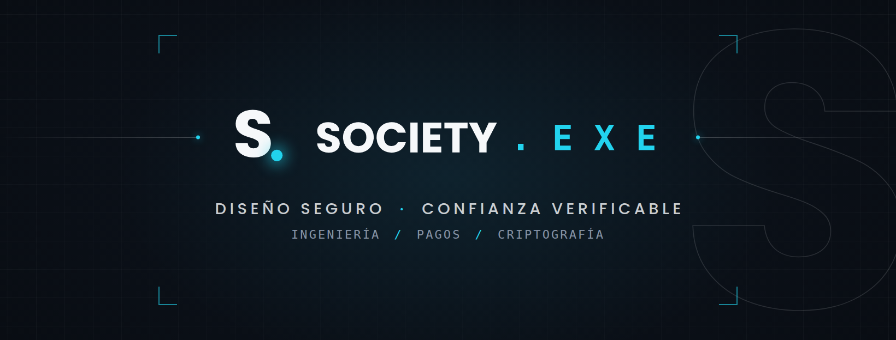

 

### Ahiézer Rada
**Founder & CTO · [Society . E X E](https://society-exe.site)**

Seguridad bancaria · Arquitectura criptográfica · Infraestructura de ciberseguridad

 

### 👋 Sobre mí

Ingeniero en Sistemas con Maestría en Ciberseguridad especializada en sistemas POS cifrados. Mi trayectoria pasa por desarrollo para terminales de pago (**Ingenico APOS A8**, **Dspread 4GDOCK**), mensajería **ISO 8583**, especificaciones **EMV** y los estándares **DUKPT** y **EFTSec** que protegen hoy las transacciones bancarias.

En julio de 2023 fundé **Society . E X E**, mi firma de ingeniería enfocada en seguridad bancaria, arquitectura criptográfica e infraestructura de ciberseguridad para el sector financiero.

 

### 🔐 En lo que estoy trabajando

**[OTP-X](https://society-exe.site/status)** — una propuesta de autenticación de un solo uso que añade una capa de verificación de *coherencia de acceso* (huella de dispositivo, comportamiento, señales de riesgo) a lo que hoy validan OTP, TOTP y HOTP, apoyada conceptualmente en DUKPT y EFTSec.

> ⚠️ OTP-X se encuentra en **fase de definición técnica y legal**. No cuenta con certificación, evaluación independiente ni aprobación regulatoria. Más detalle en [society-exe.site/status](https://society-exe.site/status).

 

### 🧰 Stack y herramientas

`ISO 8583` · `EMV` · `DUKPT` · `EFTSec` · redes CISCO · CCTV y control de acceso biométrico · Scrum

 

### 📊 GitHub

 

### 📬 Contacto

| | |
|---|---|
| ✉️ Correo | ahidroid.exe@gmail.com |
| 📞 Teléfono | +57 322 321 3752 |
| 🌐 Sitio web | [society-exe.site](https://society-exe.site) |
| 🏢 GitHub — Organización | [@Society-E-X-E](https://github.com/Society-E-X-E) |
| 📘 Facebook | [@Societyexe](https://facebook.com/Societyexe) · [@devcrackpy](https://facebook.com/devcrackpy) |

 

 
<strong>SOCIETY . E X E</strong> — Diseño seguro · Confianza verificable

